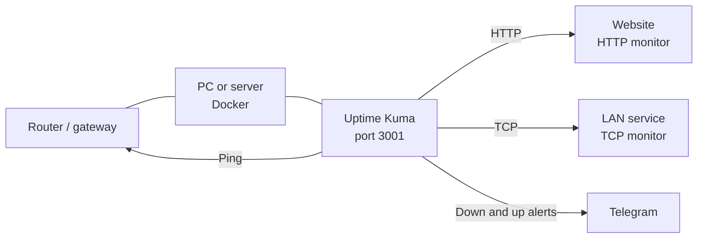
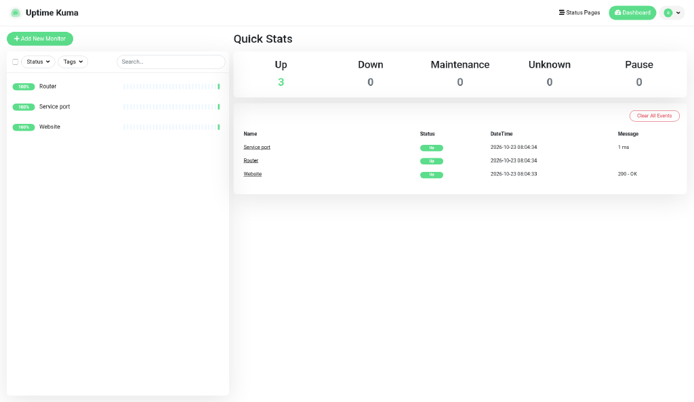
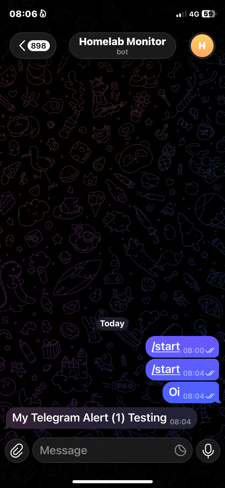

# Homelab monitoring

[](https://github.com/ottonielmorais2008-rgb/homelab-monitoring/actions/workflows/ci.yml)

Self-hosted uptime monitoring for a home lab or small network. [Uptime Kuma](https://github.com/louislam/uptime-kuma) runs in Docker and checks a website, the router, and a TCP port. When a check fails, and when it recovers, a Telegram message arrives.

This repository is a deployment you can clone and run. It is separate from the Uptime Kuma application, which stays in its own project and is pulled as the published image `louislam/uptime-kuma:2`.

## Why

A small network fails in ordinary ways: the WAN link drops, the router stops answering, a service closes its port. A dashboard on the LAN shows the current state, and Telegram carries the same event to a phone so the outage is visible away from the desk.

## Network



The Docker host publishes the dashboard on port 3001. Uptime Kuma reaches targets from the container network: ICMP to the gateway, HTTP to a site, and a TCP handshake to a chosen port. Alerts leave the LAN through Telegram's Bot API (`api.telegram.org`).

## Monitors to set up

Create these three after the first admin account exists. Use a 60 second heartbeat and 2 retries on each so one lost packet does not page you.

| Monitor | Type in the UI | Target | What "down" means |
| --- | --- | --- | --- |
| Website | HTTP(s) | A URL you care about, such as `https://example.com` | The HTTP status is outside 200-299, or the request times out |
| Router | Ping | The LAN gateway | The gateway stops answering ICMP |
| Service port | TCP Port | A host and a port that is open when the device is healthy | The TCP handshake fails |

Find the gateway on the Docker host:

```bash
ip route show default
```

Use the address after `via` (often `192.168.1.1`). For the TCP monitor, use that same host and a port you know is open, such as the router admin page on `80` or `443`, or SSH on `22` on a machine you run. On the monitor, open **Notifications** and select the Telegram notification from the next section.

## Quick start

Requirements: Docker Engine and the Docker Compose v2 plugin.

```bash
git clone https://github.com/ottonielmorais2008-rgb/homelab-monitoring.git
cd homelab-monitoring
cp .env.example .env
docker compose up -d
```

`.env` is optional for the first start. The Compose file defaults to port `3001` and timezone `Europe/Lisbon`. Edit `.env` when you want a different host port or timezone, then run `docker compose up -d` again.

Open `http://localhost:3001` on the Docker host, or `http://<host-ip>:3001` from another device on the LAN. On the first visit, create the admin account before anyone else who can reach that port does. Uptime Kuma has no login until that account exists.

Check the container:

```bash
docker compose ps
```

The status becomes `healthy` after the app finishes booting. The healthcheck allows up to three minutes on a cold start, matching the check built into the image (`extra/healthcheck`).

Monitor configuration and history are stored in the named volume `homelab-monitoring-data`, mounted at `/app/data`. The upstream project documents that NFS is an unsupported filesystem for this directory; a local Docker volume is the right place for it.

Day to day:

```bash
docker compose logs -f uptime-kuma
docker compose pull && docker compose up -d
docker compose down
```

`docker compose down` stops the stack and keeps the volume. Deleting that volume deletes monitor history.

## Telegram setup

Uptime Kuma sends Telegram messages from a notification you create in the dashboard. The bot token and chat id live in that form. `TELEGRAM_BOT_TOKEN` and `TELEGRAM_CHAT_ID` in `.env` are the local copy you paste from. The Compose service does not receive them, so filling in `.env` alone does not enable alerts.

1. In Telegram, open [@BotFather](https://t.me/BotFather) and send `/newbot`.
2. Follow the prompts for a display name and a username that ends in `bot`.
3. BotFather replies with a token. Put it in `.env` as `TELEGRAM_BOT_TOKEN`.
4. Open a chat with the new bot and send any message, for example `/start`. The bot needs at least one incoming message before a chat id exists. For a group, add the bot to the group and send a message there. The bot only needs permission to send alerts; it does not need to read the group's history.
5. In the dashboard, go to **Settings → Notifications → Setup Notification**, and choose **Telegram**.
6. Paste the bot token into **Bot Token**.
7. Set **Chat ID** with **Auto Get**. That calls Telegram's `getUpdates` method from the dashboard and fills the id of the latest chat that messaged the bot. A group id is negative. You can do the same lookup yourself:

   ```bash
   set -a
   . ./.env
   set +a
   curl -fsS "https://api.telegram.org/bot${TELEGRAM_BOT_TOKEN}/getUpdates"
   ```

   Read `message.chat.id` (or `channel_post.chat.id`) and store it as `TELEGRAM_CHAT_ID`.
8. Leave **Server URL** at `https://api.telegram.org` unless you run your own Bot API server.
9. Click **Test**. A message should arrive in that chat. Save the notification.
10. Edit each monitor and enable this notification. New monitors can inherit it when the notification is set as the default.

**Message Thread ID** is only for a topic inside a Telegram forum group. **Send silently** and **Protect content** are optional.

## Testing the alert

Prove the path with a disposable web server on the same Docker network, then stop it on purpose.

1. In Uptime Kuma, confirm the Telegram notification's test message arrived.
2. Start a temporary site attached to this project's network:

   ```bash
   docker run -d --name alert-fixture --network homelab-monitoring_default nginx:stable-alpine
   ```

3. Add an HTTP(s) monitor:
   - Friendly name: `Alert test`
   - URL: `http://alert-fixture:80`
   - Heartbeat interval: `20` seconds
   - Retries: `0`
   - Notifications: the Telegram notification
4. Wait until the monitor is up.
5. Stop the site:

   ```bash
   docker stop alert-fixture
   ```

6. On the next check, the monitor turns down and Telegram receives a down message that names `Alert test`.
7. Bring the site back and wait for the recovery message:

   ```bash
   docker start alert-fixture
   ```

8. Remove the test monitor in the dashboard, then remove the container:

   ```bash
   docker rm -f alert-fixture
   ```

`alert-fixture` resolves only on the `homelab-monitoring_default` network, which Compose creates from the project name in `docker-compose.yml`. A check of `host.docker.internal` reaches ports the Docker host publishes on its LAN address. A port bound only to `127.0.0.1` on the host is not visible at that name.

## Backup

`scripts/backup.sh` writes a gzip archive of `homelab-monitoring-data` to `backups/`. The archive holds the SQLite database and the rest of `/app/data`. The script stops Uptime Kuma for the copy, then starts it again, so the database is not archived mid-write. Expect a short gap in checks while it runs.

```bash
chmod +x scripts/backup.sh
./scripts/backup.sh
```

Archives stay on the machine. `backups/` is listed in `.gitignore`.

## Screenshots

`docs/screenshots/README.md` lists what each capture should show.



`docs/screenshots/dashboard.png` — live capture of the dashboard with the HTTP, ping, and TCP monitors up.



`docs/screenshots/telegram-alert.png` — live capture of a Telegram chat with the Homelab Monitor bot notification.

## Skills shown

- **Docker.** Compose service on the published `louislam/uptime-kuma:2` image, a named volume, a restart policy, a healthcheck, and a volume backup script.
- **Networking.** LAN gateway discovery, HTTP and TCP checks from a container, Docker DNS on the Compose network, and a published dashboard port.
- **Monitoring.** Three monitor types (HTTP, ICMP ping, TCP) with intervals and retries chosen so a single blip does not alert.
- **Alerting.** A Telegram bot, a chat id, a dashboard notification, and an end-to-end test that stops a service and waits for the message.
- **CI.** GitHub Actions runs `docker compose config` and lints YAML and Markdown on every push and pull request.

## License

[MIT](LICENSE). Uptime Kuma is a separate project; its license and source are at [louislam/uptime-kuma](https://github.com/louislam/uptime-kuma).
